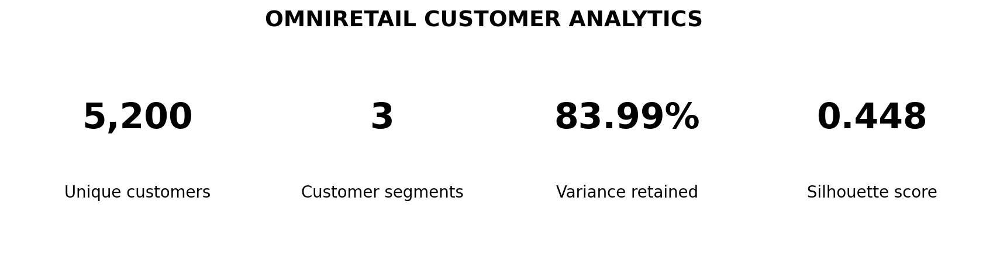
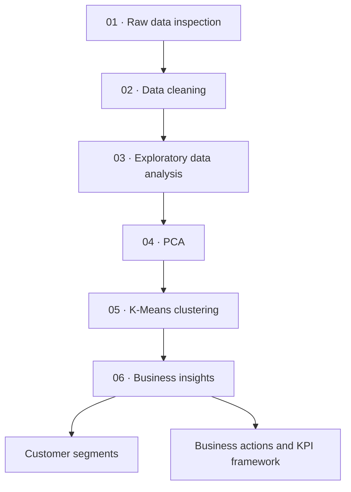
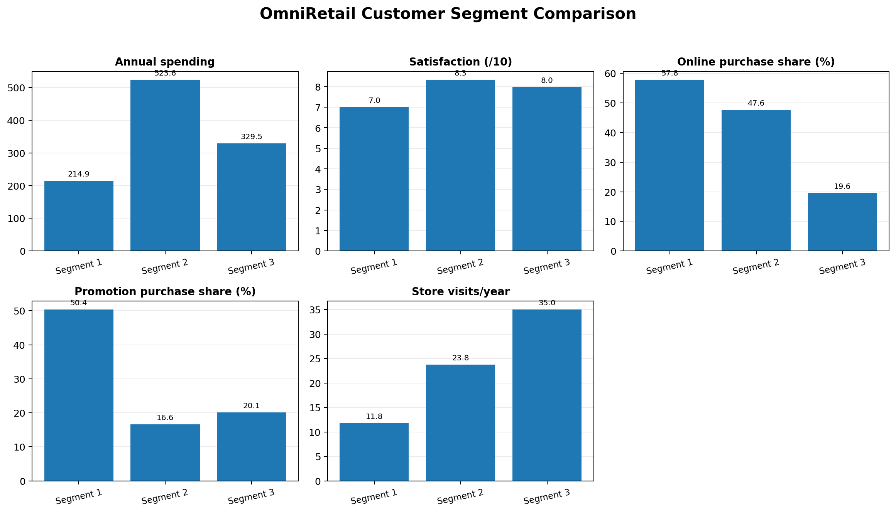
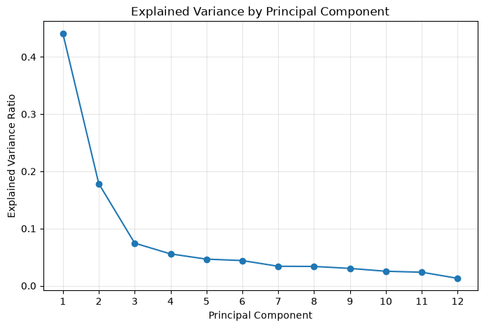
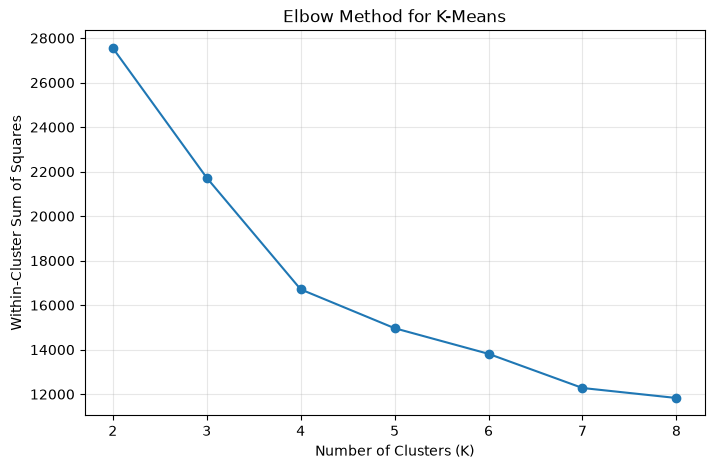
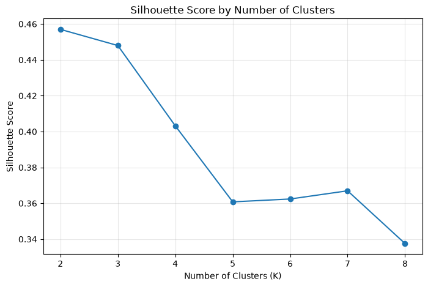

# OmniRetail Customer Analytics

### From customer data to actionable retail strategy

**[🚀 Explore the Live Dashboard](https://omnimart-customer-insights.streamlit.app/)** · **[📂 View Source Code](https://github.com/ASChauhan2004/omnimart-customer-segmentation)**

**Data Cleaning · Exploratory Analysis · PCA · K-Means · Customer Segmentation**

[Explore the notebooks](#notebook-guide) · [View the segments](#customer-segments) · [Review the methodology](#methodology) · [Business recommendations](#business-decisions-and-measurement)

---

## The project at a glance

This project analyses **5,200 unique retail customers** to identify behavior-based customer segments and translate the findings into practical marketing, loyalty, and engagement recommendations.

The workflow covers data quality checks, cleaning, exploratory data analysis, principal component analysis (PCA), K-Means clustering, segment profiling, categorical association tests, and a KPI measurement plan.

## Analytical workflow

## Key results

| Measure | Result |
|---|---:|
| Unique customers after cleaning | 5,200 |
| Numerical features used for PCA | 12 |
| Principal components retained | 6 |
| Variance retained by six components | 83.99% |
| Selected K-Means segments | 3 |
| Silhouette score for the three-cluster PCA solution | 0.448 |
| Adjusted Rand Index: PCA vs. original features | 0.9994 |

The two clustering approaches produced nearly identical assignments (ARI = 0.9994). The PCA-based model had a higher silhouette score, higher Calinski–Harabasz index, and lower Davies–Bouldin index in the comparison performed.

## Customer segments

<strong>Segment 1 — Digital, Promotion-Dependent Customers</strong> · 3,028 customers (58.23%)

**Observed profile**
- Highest online purchase share: **57.82%**
- Highest promotion-purchase share: **50.37%**
- Lowest average annual spending: **214.92** in the dataset's recorded units
- Average satisfaction: **7.00/10**
- Highest average complaint count: **2.31**

**Business decision:** Improve profitable repeat purchasing and customer experience without relying on blanket discounts.

**Actions to test:** Targeted purchase-linked offers, complaint-driver analysis, loyalty milestones, and relevant complementary-product recommendations.

**KPIs:** Repeat purchase rate, average basket value, complaint rate, promotion redemption, and incremental contribution margin.

<strong>Segment 2 — High-Value, Omnichannel Customers</strong> · 1,076 customers (20.69%)

**Observed profile**
- Highest average annual spending: **523.65** in the dataset's recorded units
- Highest average basket value: **6,155.74**
- Highest average loyalty points: **6,772.13**
- Highest average satisfaction: **8.34/10**
- Gold and Platinum members together: **79.5%**

**Business decision:** Retain high-value customers and protect long-term customer value.

**Actions to test:** Personalized loyalty benefits, premium service experiences, relevant cross-selling, and a consistent online/in-store experience.

**KPIs:** Retention rate, repeat purchase rate, customer lifetime value, and contribution margin per customer.

<strong>Segment 3 — Established, Store-Oriented Customers</strong> · 1,096 customers (21.08%)

**Observed profile**
- Highest average store visits: **35.02 per year**
- Lowest online purchase share: **19.59%**
- Longest average tenure: **111.55 months**
- Average annual spending: **329.47** in the dataset's recorded units
- Average satisfaction: **7.98/10**

**Business decision:** Strengthen store engagement and customer value while making digital services conveniently available.

**Actions to test:** In-store loyalty benefits, complementary-product offers, and optional digital ordering/account features.

**KPIs:** Repeat store visits, average basket value, retention rate, and digital adoption.

## Methodology

### 1. Data inspection and cleaning
The raw workbook contained 5,450 records representing 5,200 customer IDs. Duplicate records, invalid values, missing values, inconsistent categories, and date constraints were reviewed before analysis. The cleaned dataset contains one row per customer.

### 2. Exploratory data analysis
EDA examined demographic distributions, spending and income, purchase behavior, loyalty, satisfaction, complaints, channels, and correlations. Relationships are interpreted as associations rather than evidence of causation.

### 3. Principal Component Analysis
Twelve standardized numerical features were reduced to six principal components, retaining approximately **83.99%** of the variance.

### 4. K-Means clustering and validation
K-Means solutions for K = 2 through K = 8 were compared using inertia, silhouette score, Davies–Bouldin index, and Calinski–Harabasz index. Three clusters were retained for their business interpretability, despite K = 2 having a slightly higher silhouette score.

### 5. Categorical association tests
Chi-square tests and Cramér's V examined associations between customer segments and membership tier, city tier, preferred category, region, and acquisition channel. Holm correction was used for multiple testing.

Membership tier showed a strong association with segment membership (Cramér's V = 0.6002, Holm-adjusted p < 0.001). The other four variables showed negligible associations and were not statistically significant after correction.

## Business decisions and measurement

| Segment | Priority | Example measures |
|---|---|---|
| 1 — Digital, promotion-dependent | Improve profitable repeat purchasing and address complaints | Repeat purchase rate, basket value, complaints, incremental margin |
| 2 — High-value, omnichannel | Retain valuable customers and protect margin | Retention, lifetime value, repeat purchase, contribution margin |
| 3 — Established, store-oriented | Deepen store engagement and customer value | Repeat visits, basket value, retention, digital adoption |

Some baseline metrics can be calculated from the current customer snapshot. Retention, campaign redemption, and incremental profitability require transaction-level, campaign, cost, or longitudinal data. Targets should be set after reviewing baselines and piloting interventions.

## Notebook guide

The repository preserves the project's existing directory structure and relative paths.

| Notebook | Contents |
|---|---|
| [`01_Raw_Data_Inspection.ipynb`](Notebooks/01_Raw_Data_Inspection.ipynb) | Raw data quality and structure |
| [`02_Data_Cleaning.ipynb`](Notebooks/02_Data_Cleaning.ipynb) | Cleaning, reconciliation, and validation |
| [`03_EDA.ipynb`](Notebooks/03_EDA.ipynb) | Exploratory analysis and correlations |
| [`04_PCA.ipynb`](Notebooks/04_PCA.ipynb) | Standardization, PCA, explained variance, loadings |
| [`05_Customer_Clustering.ipynb`](Notebooks/05_Customer_Clustering.ipynb) | K-Means evaluation, segment profiles, model comparison |
| [`06_Segmentation_Business_Insights.ipynb`](Notebooks/06_Segmentation_Business_Insights.ipynb) | Segment strategy, statistical associations, KPI framework |

## Run the project

1. Clone or download this repository.
2. Install the packages in `requirements.txt`.
3. Keep `data/OmniRetail_Customer_Analytics_Group_Project.xlsx` in the `data/` folder. This is the original workbook used by the inspection and cleaning notebooks.
4. Open Jupyter from the repository root.
5. Run notebooks `01` through `06` in order.

The notebooks use relative paths such as `../data/...`; preserve the `Notebooks/` and `data/` directories so the current code continues to work.

## Tech stack

Python · pandas · NumPy · Matplotlib · scikit-learn · SciPy · statsmodels · openpyxl · Jupyter

## Limitations

- The clusters are exploratory segments derived from the available snapshot; they are not externally validated customer types.
- Internal clustering metrics do not prove business effectiveness or establish a uniquely correct number of clusters.
- Association tests do not imply causation.
- The recommendations are hypotheses for future testing, not proven campaign outcomes.
- Retention, campaign uplift, and profitability require additional longitudinal, transaction, campaign, or cost data.

---

**Built as an end-to-end customer analytics project — from data preparation to business decision-making.**

